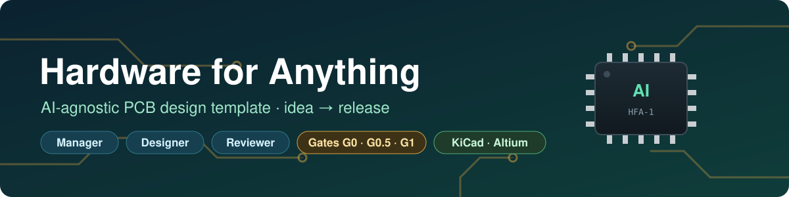
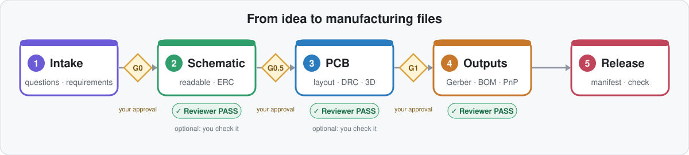
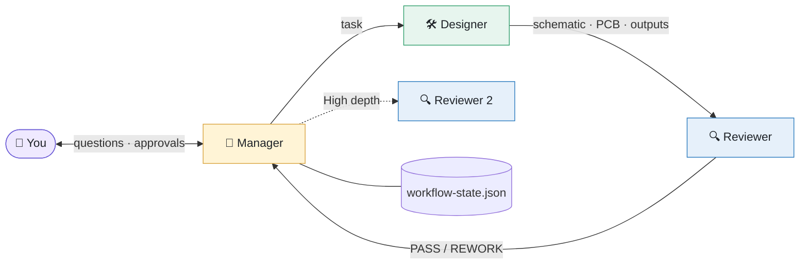
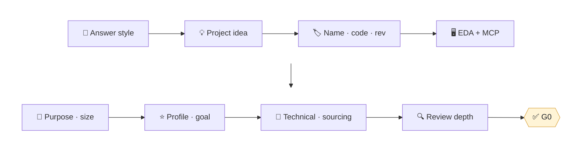
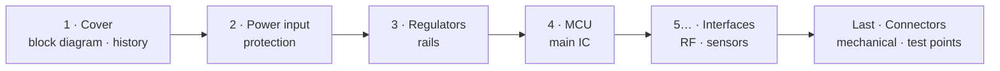
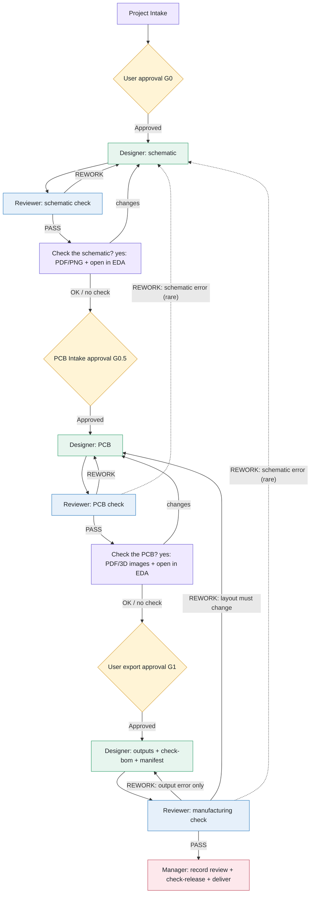

<p align="center"></p>

# Hardware for Anything · AI-Agnostic Hardware Design Template

**English** · [Türkçe](README.tr.md)

**A reproducible, model- and platform-independent hardware (PCB) design project; the cost/performance balance follows each project's goal.**

[](https://github.com/d0ukan/hardware-for-anything/actions/workflows/tests.yml) · License: [MIT](LICENSE) · Version: v1.28 ([changelog](CHANGELOG.md))

[](https://github.com/d0ukan/hardware-for-anything/generate)    

One manager agent and two specialist roles take a board from schematic to PCB, with independent review, a shared hardware library and controlled manufacturing outputs. All rule and role files are in English; AI assistants answer in your language.

| Role | Portable role file | Job |
| :--- | :--- | :--- |
| Hardware Manager | `agents/Manager.md` | Requirements, decisions, tasks and approvals |
| Hardware Designer | `agents/Designer.md` | Schematic, footprints, 3D models, PCB and fixes |
| Hardware Reviewer | `agents/Reviewer.md` | Independent design and manufacturing-output checks |

<p align="center"></p>

## At a glance

| | | | |
| :---: | :--- | :---: | :--- |
| 🤖 | **Any AI, any EDA, any OS:** Claude, Codex, Gemini …; KiCad, Altium, EasyEDA; Windows, macOS, Linux | 🚦 | **You approve each gate:** requirements G0, PCB inputs G0.5, export G1 |
| 🔍 | **Independent review:** Light, Medium or High (two Reviewers) | 📐 | **Readable schematics:** wires, power symbols, standard sheets |
| 🔌 | **MCP setup offered:** for this project or all projects, only after your yes | 🌍 | **Local sourcing:** your country, user-supplied modules, drop-in alternates |
| 📡 | **Diff pairs and RF:** visible in the schematic, routed as pairs | 📦 | **Release checks:** BOM/PnP, manifest hash, git commit binding |

### How the team works



## Start in any AI chat with the repo link

The shortest path: give any AI assistant the repo link and write:

> Inspect this repo (start with AGENTS.md and llms.txt). I want to design a board using it.

The AI then ([AGENTS.md](AGENTS.md), section "AI started from a repo link"):
- Does not read every rule up front; it uses the index and the per-stage reading set, which saves tokens and credits.
- Asks you to create your own copy with GitHub's **Use this template**.
- Without file access (web chat) it keeps decisions in the chat, gives you content to paste into files and commands to run, and never reports a check that did not run. Paste the output of `projectctl.py next` and it continues from there.
- Asks the first questions in one message: answer style → project name/code/revision → purpose → quality profile → design goal.
- Requires a qualified human engineer's sign-off for mains/high voltage, multi-cell lithium, patient-connected medical or aerospace DAL A/B work (AI-09).

In a tool with file and EDA access (Claude Code, Codex, Gemini CLI, …) open your copy and follow the quick start below.

## Quick start

1. Copy this repo with **Use this template** on GitHub (or unzip it). The repo owner enables the button under **Settings → General → Template repository**.
2. Open the project folder in your AI development tool. Check file and EDA access, permissions and agent support.
3. Tell the AI:

   > Apply AGENTS.md and agents/Manager.md. Check the current state in Project-README.md and project/workflow-state.json. If this is a new project, ask the Project Intake questions; otherwise continue where we left off. Do not start a design stage before I approve it.

4. The Manager records decisions in `Project-README.md` and approvals/reviews in `project/workflow-state.json`. Requirements are approved before G0; PCB inputs at G0.5 before layout.
5. Work is handed to the Designer or Reviewer only when needed. Next step and its command: `python scripts/projectctl.py next`.

## First questions



## Project identity and output names

Right after the answer-style question, the Manager asks for the project name, project code, revision and any variant (INT-49). You choose the code format. Every output is named from it:

| Case | Prefix | Example files |
| :--- | :--- | :--- |
| Revision | `DR00627-R01` | `DR00627-R01_BOM.csv`, `_PnP.csv`, `_SCH.pdf`, `_ASSY.pdf`, `_Gerber.zip` |
| Variant A | `DR00627-AV-R01` | `DR00627-AV-R01_BOM.csv`, `DR00627-AV-R01_PnP.csv` |

- Copper, outline or stack-up changes → new **revision**; only fitted parts change → **variant** (REL-01).
- On a revision bump the user is asked "what changed, and why?" and the answer goes to `REVISION-HISTORY.md` (REL-02).
- The AI asks "What would you like to build? Or shall I suggest some ideas?" If you want ideas, it offers 3–5 ideas based on your earlier projects and interests (INT-55). It never starts a project you did not pick.
- Early questions include the **size limit** (max L × W × H incl. connectors, or "as small as possible" / "no limit", INT-19) and the **layer count**: your target, or the AI picks the lowest suitable count (2, 4, 6 …) and says why (INT-20).
- **Check the design yourself (optional):** after the schematic review the AI asks "The schematic is done. Do you want to check it?" On yes it shows the schematic as PDF and images and asks you to open it in your EDA tool; on no it continues. The same for the PCB with 3D images before G1 (SCH-08, LAY-32).
- **Schematics a human can read** (SCH-09…12): real wires inside blocks, power symbols for supplies, few net labels, no overlapping text, left-to-right flow. The AI checks a PNG of its own drawing, runs ERC and lists the nets; the Reviewer returns REWORK if it is hard to read (REV-15).
- Every component gets at least one drop-in alternate where possible (DFM-14).
- **Standard schematic sheets:** every sheet uses the same template (A4 landscape, KiCad `.kicad_wks` in `Hardware-Library/sheet-templates/`) with a full title block (name, code, revision, variant, sheet x/y, date, designer, reviewer) and a fixed sheet order: cover → power → regulators → MCU → interfaces → connectors (SCH-14, SCH-15, REV-18).



- **Differential pairs are clear and routed as pairs:** in the schematic they are drawn side by side with a note like "USB D+/D− · 90 Ω diff" and named so the EDA recognizes them; on the PCB they are routed with the diff pair router at constant spacing, and a pair table (impedance, length difference) goes to the Reviewer (SCH-13, DIF-09…11, REV-17).
- **Local sourcing for modules:** the AI asks your country and where the board is assembled. For a module or part the PCBA house does not stock, it asks where you can buy it (and checks local shops if it can), uses a stocked socket where possible, draws the footprint from the exact product you buy (clones often differ) and marks it USER-SUPPLIED / DNP in the PCBA BOM (INT-56, INT-57, DFM-16).
- **Review depth** is asked at the start (INT-53). Risky boards (Aerospace, RF, battery, above SELV) need at least Medium.

  | Depth | Reviewers | Checks |
  | :--- | :---: | :--- |
  | 🟢 **Light** | 1 | Critical checks only |
  | 🟡 **Medium** (default) | 1 | Full checklist |
  | 🔴 **High** | 2 independent | Full checklist twice; both must PASS |

- Non-critical questions (logo, silkscreen text, designators, signature) offer **"decide later"**; anything on the board is settled by G0.5 at the latest (INT-51).
- Silkscreen questions (PCB-17…21): logo/icon, board code (silk/copper, top/bottom), connector labels (pin number/net name), designators (visible/hidden, size, position), signature/easter egg. Silkscreen never overlaps on either side (LAY-30).
- Output set (section 09): Gerber, BOM, PnP, schematic PDF, Draftsman-style assembly drawing (`_ASSY.pdf`), fab notes. Empty templates live in `Manufacturing/templates/`, with bring-up and review checklists.

## Quality profiles

The Manager asks for the board's level at the start. The profile sets how strict the rules are; every default can be changed.

| Profile | For | What changes |
| :--- | :--- | :--- |
| 🧪 **Hobby** | Personal projects, prototypes, lowest cost | JLCPCB/PCBWay standard process, fewest layers, cheap and easy sourcing |
| 🏭 **Industrial** | Reliable long-term field use | −40…+85 °C parts, input protection, long-life multi-source parts |
| ✈️ **Aerospace** | Flight, military, high reliability | Section 08: IPC Class 3, derating, DO-160/MIL-STD requirements, traceability |

**A design goal is also chosen (INT-48):** cost first, balanced (price/performance) or performance first. Suggested defaults: Hobby → cost, Industrial → balanced, Aerospace/military → performance (unless a cost target is given). No goal ever cuts reliability or verification to save money.

**RF, battery and aerospace sections are optional.** If they don't apply, their rules and questions are skipped. With RF the band is asked: RF-A (< 1 GHz), RF-B (1–6 GHz), RF-C (> 6 GHz).

## Repository layout

| File / folder | Purpose |
| :--- | :--- |
| `README.md`, `README.tr.md` | English and Turkish overview |
| `AGENTS.md` | Shared instructions for every AI system, including the "repo link only" entry |
| `llms.txt` | Entry files for AI tools |
| `agents/` | Platform-independent role and hand-off instructions |
| `.codex/`, `CLAUDE.md`, `.claude/agents/`, `GEMINI.md` | Optional Codex, Claude Code and Gemini CLI adapters |
| `Hardware-Rules.md` | Rule index and per-stage reading set |
| `rules/` | Technical rules split by section (00 intake … 10 battery) |
| `Hardware-Roles.md` | Roles, workflow, review and token policy |
| `examples/` | Filled example project (`DR00001` USB-C LED board); CI checks it on every push |
| `Hardware-Library/` | Verified symbols, footprints, 3D models, circuit blocks and the standard schematic sheet template (`sheet-templates/`) |
| `Hardware/` | Native EDA project (KiCad, Altium, …) |
| `Mechanical/` | Project-specific mechanical sources and optional full CAD assembly |
| `Manufacturing/` | Outputs created after approval; `templates/` holds empty BOM, PnP, schematic-output, assembly-drawing, fab-notes templates and checklists |
| `Project-README.md` | Project facts, requirements and decisions; kept current by the Manager |
| `REVIEW_LOG.md` | Independent review findings (`F-001` …) |
| `REVISION-HISTORY.md` | Revision history: what changed, why, errata |
| `project/workflow-state.json` | Machine-checkable workflow state |
| `scripts/projectctl.py` | Model-free approval, commit binding, BOM/PnP, deliverables and release checks; `next` |
| `scripts/check_repo.py` | Template consistency: rule IDs, index ranges, links, versions, CSV |
| `tests/`, `.github/workflows/` | Automated tests and CI |
| `MCP-SETUP.md`, `examples/mcp/` | MCP setup per EDA tool and AI client, example config |
| `CHANGELOG.md`, `LICENSE`, `CONTRIBUTING.md` | Version history, MIT license, contribution rules |

## Workflow



Every Reviewer check ends in `PASS`, `REWORK` or `BLOCKED`. On `REWORK` the Designer fixes and the Reviewer re-checks the affected areas. If only an output is wrong, only outputs are regenerated; if the layout must change, work returns to PCB and G1 is approved again. If the PCB or manufacturing check finds a schematic error (rare, dashed arrows), work returns to the schematic: schematic review, PCB update and review, and G1 are redone (`projectctl` invalidates the old records when schematic files change). `BLOCKED` stops the flow until the missing information, tool or approval arrives.

**Release order (REL-04):** the Manager records the deliverables → the Designer creates the outputs, runs `check-bom` and finally `manifest` → the Reviewer checks them → the Manager records `review manufacturing PASS` (the manifest hash is stored) → `check-release`.

## Tokens and price/performance

- The main session is the Manager; no third sub-agent is started.
- At each stage the AI reads only the files in the "Reading set by stage" table in `Hardware-Rules.md`.
- Simple work is done first with deterministic tools (`projectctl.py`, `check-bom`).
- The default model/effort is economical; harder technical work moves to a stronger model.
- Verified library entries are reused; reports stay short.

### Model choice and platform adapters

No model names or providers are fixed. Map Economy, Standard and Advanced tiers to what your client offers.

| Environment | Use |
| :--- | :--- |
| Codex | Optional `.codex/` settings; Manager as the main session, Designer/Reviewer as custom agents. |
| Claude Code | `CLAUDE.md` imports the shared rules; `.claude/agents/` points to the same specialist roles. |
| Gemini CLI | `GEMINI.md` imports the shared rules. |
| DeepSeek and others | Use the same role files if the client supports agents/tools; otherwise the manual hand-off in [agents/README.md](agents/README.md). |

The Reviewer not writing is a role rule, not an OS sandbox. Official adapter references: [Codex subagents](https://learn.chatgpt.com/docs/agent-configuration/subagents), [Claude Code subagents](https://code.claude.com/docs/en/sub-agents), [Claude Code project instructions](https://code.claude.com/docs/en/memory), [Gemini CLI context files](https://geminicli.com/docs/cli/gemini-md/).

### Switching AI and continuing

The project stays in one conversation; the AI never asks you to open a new chat (AI-10). If you switch AI yourself, the new session works from `AGENTS.md`, the assigned role and the current `Project-README.md`, `project/workflow-state.json` and `REVIEW_LOG.md`; `projectctl.py next` names the next step. You can use one model as Designer and another as Reviewer; earlier approvals and real review records stay valid.

## EDA & MCP integration

The template does not depend on one EDA tool or MCP server. MCP, native CLI, scripting/API or GUI all work. The AI asks your EDA tool first and offers to set up the matching MCP server, for this project only or for all projects; it installs only after your yes (INT-54). Steps: [MCP-SETUP.md](MCP-SETUP.md).

| EDA | Integration options and sources |
| :--- | :--- |
| KiCad | [Native CLI](https://docs.kicad.org/10.0/en/cli/cli.html), [IPC API](https://dev-docs.kicad.org/en/apis-and-binding/ipc-api/index.html), [KiCAD-MCP-Server](https://github.com/mixelpixx/KiCAD-MCP-Server), [Seeed kicad-mcp-server](https://github.com/Seeed-Studio/kicad-mcp-server) |
| Altium Designer | [Official MCP Server](https://docs.developer.altium.com/ad-mcp-docs/), [altium-mcp](https://github.com/coffeenmusic/altium-mcp), [scripting](https://www.altium.com/documentation/altium-designer/scripting) |
| EasyEDA Pro | [Official Extension API](https://prodocs.easyeda.com/en/api/guide/) and a [third-party MCP example](https://github.com/vlab-software/easyeda_mcp) |
| Autodesk EAGLE (legacy) | Autodesk discontinued EAGLE in June 2026. Use it only to read existing projects or migrate them to KiCad/Fusion. |

The MCP version, EDA compatibility and real tool functions are verified at project start. A Reviewer using MCP works only with read tools (REV-13).

**With [KiCAD-MCP-Server](https://github.com/mixelpixx/KiCAD-MCP-Server):**
- Use the `stable` branch, v2.9 or newer.
- Start with `KICAD_MCP_TOOLBOXES=core` to save tokens.
- Reviewer: `KICAD_MCP_OPERATING_MODE=readonly`; export only: `manufacturing`.
- Use the autorouter (Freerouting) only on non-critical nets via `routeNets`/`excludeNets` (LAY-14).
- Keep the schematic closed in KiCad while it is edited.
- `KICAD_MCP_DEV=1` writes session logs to `logs/`, which is in `.gitignore`.

**With [altium-mcp](https://github.com/coffeenmusic/altium-mcp):**
- There is no read-only mode; the Reviewer uses only `get_*`, `check_*`, `run_drc`, ERC, `preview_eco`, `compare_netlist`.
- Stack-up, impedance, diff-pair and length-matching rules are entered in Altium by hand.
- `route_connections` is an autorouter; never on critical nets (LAY-14). `run_altium_script` needs user approval each time.
- Save and close documents before `git pull`/`checkout`. Point OutJob outputs at `Manufacturing/<rev>/`; changes to `*.OutJob` do not count as design changes.
- Altium design files are binary; only one person edits a file at a time.

## Placement and routing

Section 04 (`rules/04-schematic-layout.md`):

| Group | Rules | In short |
| :--- | :--- | :--- |
| Schematic | SCH-01…SCH-07 | Blocks, datasheets, power tree (PI), per-pin decoupling, SI preparation, constraint marking, 0 Ω / DNP option footprints |
| General | LAY-01…LAY-07 | Decoupling, power traces, partitioning, reference plane, 45°, test points, silkscreen |
| Placement | LAY-08…LAY-13 | Reference layout, placement order, input protection, switching loop, crystal, thermal, alignment |
| Routing | LAY-14…LAY-24 | Routing order, net classes and IPC-2152, layer use, split planes, clock spacing (3W center-to-center), analog ground, power distribution, high voltage, pad entry/teardrops, shortest direct path, approved free-angle routing |
| SI / PI | LAY-25…LAY-29 | Decoupling loop, critical length, impedance matching, length/delay matching, final check |
| Silkscreen | LAY-30…LAY-31 | Overlap-free silkscreen on each side; applying the marking decisions |

Without special manufacturing needs, JLCPCB and/or PCBWay standard capabilities are the baseline (DFM-00).

## Battery, RF and high-speed

- **Battery (section 10, BAT-01…08):** enabled when the board runs from or charges a battery: protection, charger IC, NTC, layout, sleep current, tests.
- **RF and high-speed (section 05):** controlled impedance, SI/PI profile and band-tiered RF rules (RF-01…RF-09). N/A for slow boards. The template alone does not guarantee RF performance.

## Local check commands

Python 3.10+ is enough; no packages, API keys or LLM calls. Works the same on **Windows, macOS and Linux** (CI runs every push on all three).

| OS | Install Python | Command |
| :--- | :--- | :--- |
| 🪟 Windows | python.org installer or `winget install Python.Python.3.12` | `python` (or `py`) |
| 🍎 macOS | `brew install python` or python.org installer | `python3` |
| 🐧 Linux | distro package (`apt install python3`, `dnf install python3`) | `python3` |

The examples below use `python`; on macOS/Linux type `python3` if `python` is not found.

```bash
python scripts/projectctl.py next            # next missing step and its command
python scripts/projectctl.py status
python scripts/projectctl.py check-layout
python scripts/projectctl.py check-export
python scripts/projectctl.py check-bom
python scripts/projectctl.py check-release
python -m unittest discover -s tests -v
python scripts/check_repo.py
```

Never edit the JSON by hand; use the commands. `--revision` always equals `design_revision` (e.g. `R01`). The full order is in [project/README.md](project/README.md); short version:

```bash
python scripts/projectctl.py set project_name "Sensor board"
python scripts/projectctl.py set project_code DR00627
python scripts/projectctl.py set design_revision R01
python scripts/projectctl.py set requirements_revision REQ-1
python scripts/projectctl.py set review_depth Medium
python scripts/projectctl.py approve G0 --revision REQ-1 --evidence "User approval" --by "<name>"
python scripts/projectctl.py review schematic PASS --revision R01 --evidence "REVIEW_LOG.md, R01 schematic"
python scripts/projectctl.py set pcb_requirements_revision PCB-1
python scripts/projectctl.py approve G0.5 --revision PCB-1 --evidence "User PCB approval"
python scripts/projectctl.py review pcb PASS --revision R01 --evidence "REVIEW_LOG.md, R01 PCB"
python scripts/projectctl.py approve G1 --revision R01 --evidence "User export approval"
python scripts/projectctl.py deliverables BOM PnP Gerber SCH ASSY FAB
python scripts/projectctl.py manifest
python scripts/projectctl.py review manufacturing PASS --revision R01 --evidence "REVIEW_LOG.md, R01 manufacturing"
python scripts/projectctl.py check-release
python scripts/projectctl.py block F-001
```

- **Commit binding:** in a git repository, `approve` and `review` store the current commit. If anything under `Hardware/` changes afterwards, including new untracked files, the gate closes. `review ... PASS` and `approve G1` are refused while the design has uncommitted changes.
- **Manifest binding:** `review manufacturing PASS` stores the manifest hash; regenerating the manifest later makes `check-release` ask for a new review.
- **Deliverables:** every item in `deliverables` (`<code>-..._BOM.csv`, `_Gerber.zip`, …) must exist in the release.
- **`check-bom`:** BOM/PnP match, Qty, DNP, MPN, `R1-R3` ranges, numeric coordinates; warns on missing alternates. Gives a clear error for semicolon-separated or non-UTF-8 CSV files.

On a new project `check-layout`, `check-export` and `check-release` fail; that is expected. The tool checks that records are consistent; it does not prove an approval is genuine or the board is electrically correct, and it does not create Gerber/BOM/PnP files.

## Large files

When STEP models and zipped outputs grow, consider Git LFS in your project copy: `git lfs install` and `git lfs track "*.step" "*.zip"`. The template does not enable LFS by default.

## Growing the hardware library

Add only verified, properly licensed, reusable assets, following [Hardware-Library/README.md](Hardware-Library/README.md) and the shared footprint layer map (DFM-15).

> This template is not a finished PCB design. EDA tool, manufacturer, components, electrical design and real verification are decided per project. The AI's permissions are limited to the current session and the user's decisions.
