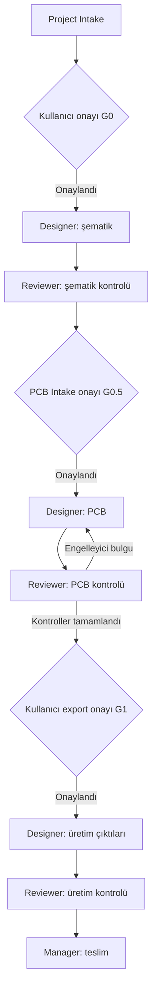

# Hardware Design · AI-Agnostic Template

**Model ve platformdan bağımsız, tekrarlanabilir donanım tasarım projesi; maliyet/performans dengesi proje hedefine göre seçilir.**

[](https://github.com/d0ukan/ai-hw-designer/actions/workflows/tests.yml) · Lisans: [MIT](LICENSE) · Sürüm: v1.11 ([değişiklikler](CHANGELOG.md))

Bu şablon tek bir yönetici ajan ve iki uzman rol ile şematikten PCB'ye kadar tasarım, bağımsız review, ortak donanım kütüphanesi ve kontrollü üretim çıktısı hazırlamak için kullanılır.

| Rol | Taşınabilir rol tanımı | Görev |
| :--- | :--- | :--- |
| Hardware Manager | `agents/Manager.md` | Gereksinimler, kararlar, görevler ve onaylar |
| Hardware Designer | `agents/Designer.md` | Şematik, footprint, 3D model, PCB ve düzeltmeler |
| Hardware Reviewer | `agents/Reviewer.md` | Bağımsız tasarım ve üretim dosyası doğrulaması |

## Hızlı başlangıç

1. ZIP'i aç veya bu repository'yi GitHub'da template repository olarak kullanıp yeni bir proje oluştur.
2. Proje klasörünü kullandığın AI geliştirme aracında aç. (Codex, Claude Code, Gemini CLI, DeepSeek kullanan bir IDE/agent istemcisi veya başka bir araç.) Dosya ve EDA erişimini, yetkileri ve ajan desteğini kontrol et. Dosya erişimi olmayan sohbet aracında yalnızca gerekli dosyaları veya ilgili bölümleri paylaş.
3. Kullandığın AI'a şu talimatı ver:

   > AGENTS.md ve agents/Manager.md talimatlarını uygula. Project-README.md ve project/workflow-state.json dosyalarındaki mevcut durumu kontrol et. Yeni projeyse Project Intake sorularını sor; mevcut projeyse kaldığımız yerden devam et. Onayım gelmeden ilgili tasarım aşamasına başlama.

4. Manager ilk görüşmede kullanıcının anlatım tercihini (Caveman / Balanced / Detailed) sorar. Gereksinimleri ve kararları `Project-README.md` dosyasına, onay/review durumunu ise `project/workflow-state.json` dosyasına kaydeder. G0 öncesinde kart tipi, besleme, tek/multi-PCB, hazır modül, fiziksel konnektör, diagnostik, varsa programlama/flash/debug ve CAD teslimat tercihlerini netleştirir; layout öncesinde G0.5 ile PCB teknolojisi, malzeme, kalite, köşe geometrisi ve isteğe bağlı şase halkasını onaylatır.
5. Aktif görev gerektiğinde Designer veya Reviewer'a verilir. Üç rol sürekli çalışmaz.

## Kalite profilleri

Manager proje başında kartın seviyesini sorar. Profil kuralların sertliğini belirler; kullanıcı her varsayılanı değiştirebilir.

| Profil | Ne için | Ne değişir |
| :--- | :--- | :--- |
| **Hobi** | Kişisel proje, prototip, en düşük maliyet | JLCPCB/PCBWay standart hattı, en az katman, ucuz ve kolay tedarik |
| **Endüstriyel** | Sahada uzun süre güvenilir çalışma | −40…+85 °C komponent, giriş korumaları, uzun ömürlü ve çok kaynaklı parça |
| **Havacılık** | Uçuş, askeri, yüksek güvenilirlik | `Hardware-Rules.md` bölüm 08: IPC Class 3, derating, DO-160/MIL-STD isterleri, izlenebilirlik |

**Tasarım hedefi de seçilir (INT-48):** Maliyet öncelikli, Dengeli (fiyat/performans) veya Performans öncelikli. Varsayılan öneri: Hobi → Maliyet, Endüstriyel → Dengeli, Havacılık/askeri → Performans (kullanıcı maliyet hedefi vermediyse). Performans hedefinde maliyet engel değildir ama her maliyet artışı gerekçesiyle bildirilir. Hiçbir hedefte güvenilirlik ve doğrulama maliyet için kısılmaz.

**RF isteğe bağlıdır.** Kartta RF yoksa RF kuralları ve soruları tamamen atlanır. RF varsa Manager bandı sorar ve kuralları banda göre açar: RF-A (< 1 GHz), RF-B (1–6 GHz), RF-C (> 6 GHz). Hobi projelerde önce sertifikalı hazır RF modülü önerilir.

### GitHub template olarak kullanma

ZIP'ten başladıysan Git repository'sini aşağıdaki komutlarla oluşturabilirsin:

```bash
git init -b main
git add .
git commit -m "Initialize hardware design template"
```

Daha sonra kendi boş, tercihen private GitHub repository'ne yükleyip ayarlarından **Template repository** özelliğini aç. Sonraki projelerde **Use this template** ile yeni repository oluştur. Bu şablon hiçbir uzak repository'ye otomatik olarak push yapmaz.

## Proje yapısı

| Dosya / klasör | Amaç |
| :--- | :--- |
| `AGENTS.md` | Tüm AI sistemleri için ortak çalışma talimatları |
| `agents/` | Platformdan bağımsız rol ve handoff talimatları |
| `.codex/` | İsteğe bağlı Codex adaptörü |
| `CLAUDE.md`, `.claude/agents/` | İsteğe bağlı Claude Code adaptörü |
| `GEMINI.md` | İsteğe bağlı Gemini CLI giriş dosyası; ortak AGENTS.md'ye yönlendirir |
| `Hardware-Rules.md` | Teknik tasarım, DFM, üretim ve doğrulama kuralları |
| `Hardware-Roles.md` | Roller, iş akışı, review ve token politikası |
| `Hardware-Library/` | Doğrulanmış symbol, footprint, 3D model ve devre blokları |
| `Hardware/` | Native EDA projesi (KiCad, Altium vb.) |
| `Mechanical/` | Projeye özel mekanik kaynaklar ve isteğe bağlı komple CAD assembly |
| `Manufacturing/` | Kullanıcı onayı sonrası üretilen dosyalar |
| `Project-README.md` | Başlangıçta boş proje bilgi/ister/ek kural şablonu; Manager güncel tutar |
| `REVIEW_LOG.md` | Bağımsız review bulguları |
| `project/workflow-state.json` | Makine tarafından kontrol edilebilir iş akışı durumu |
| `scripts/projectctl.py` | Modelsiz, yerel onay ve durum kontrolü |
| `tests/` | Onay kontrol aracının otomatik testleri |
| `.github/workflows/` | GitHub Actions: her push'ta testler ve şema/katalog kontrolü |
| `CHANGELOG.md` | Kural ve araç sürüm geçmişi |
| `LICENSE` | MIT lisansı |

## İş akışı



Bir incelemede hata bulunursa Designer düzeltir, Reviewer etkilenen alanları tekrar kontrol eder. Şematik veya PCB onayı geçersizleyen değişikliklerde ilgili aşamaya dönülür.

Tek PCB ve multi-PCB projeler aynı iş akışını kullanır. Birden fazla kart varsa kart ID'leri, board-to-board veya cable-to-board arayüzleri ve ortak sistem revizyonu kaydedilir. Hazır modül, karşı konnektör, diagnostik LED ve komple sistem STEP/CAD gibi seçimler kullanıcı onayına bağlıdır.

## Token ve fiyat/performans

- Ana oturum Manager'dır; üçüncü bir alt ajan başlatılmaz.
- Basit işler önce deterministik araç ve script ile çözülür.
- Varsayılan model/efor düşük maliyetlidir; zor teknik işler için uygun model seçilir.
- Ajanlar yalnızca görevle ilgili kural maddelerini ve mevcut revizyonu okur.
- Doğrulanmış kütüphane girişleri yeniden kullanılır; geçerlilik koşulları değişmişse tekrar doğrulanır.
- Kontrol raporları kısa tutulur; gereksiz simülasyon, doküman, agent döngüsü ve üretim export'u yapılmaz.

### Model seçimi ve platform adaptörleri

Model adları ve sağlayıcı sabitlenmemiştir. Economy, Standard ve Advanced seviyelerini mevcut istemcideki fiyat/performans ve yetenek seçeneklerine göre eşleştir. İşe göre desteklenen en uygun eforu seç.

| Ortam | Kullanım |
| :--- | :--- |
| Codex | İsteğe bağlı `.codex/` ayarları; Manager ana oturum, Designer/Reviewer custom agents. Low/medium efor varsayılanları desteklenen modele göre ayarlanabilir. |
| Claude Code | `CLAUDE.md` ortak kuralları içe aktarır; `.claude/agents/` aynı uzman rollerine yönlendirir. Model seçimleri istemciden yönetilir. |
| Gemini CLI | `GEMINI.md` ortak kuralları içe aktarır. Ortak rol dosyalarını kullan; ayrı `.gemini/` ajan konfigürasyonu yalnızca gerekirse eklenir. |
| DeepSeek ve diğer modeller | Kullandığın istemci/IDE ajan ve araç desteği sağlıyorsa aynı rol tanımlarını kullan; aksi halde [agents/README.md](agents/README.md) içindeki manuel görev aktarımını kullan. |

Her ortamın subagent, EDA ve dosya erişimi farklı olabilir. Özel ajan desteğini varsayma; Reviewer'ın yazmaması bir rol kuralıdır, ayrı bir işletim sistemi sandbox'ı değildir. Adaptörler zorunlu değildir. Ortak talimatlar ve yerel onay aracı hiçbir AI sağlayıcısına bağlanmaz veya API anahtarı gerektirmez.

Resmi adaptör referansları: [Codex subagents](https://learn.chatgpt.com/docs/agent-configuration/subagents), [Claude Code subagents](https://code.claude.com/docs/en/sub-agents), [Claude Code project instructions](https://code.claude.com/docs/en/memory), [Gemini CLI context files](https://geminicli.com/docs/cli/gemini-md/).

Platform klasörleri teknik tasarım için zorunlu değildir; yalnızca desteklenen istemcilerde otomatik uzman ajan keşfi/ayarları sağlar. Şablonu sade tutmak için kullanılmayacak sağlayıcılara özel ajan klasörlerini ekleme. Aynı talimatları ayrı dosyalara kopyalama veya bir istemcide iki kez yükleme; ortak kaynak `AGENTS.md` ve `Hardware-Roles.md` olarak kalır.

### AI değiştirirken kaldığın yerden devam et

Yeni oturumda `AGENTS.md`, atanacak rol ve mevcut `Project-README.md`, `project/workflow-state.json`, `REVIEW_LOG.md` üzerinden ilerle. Son tasarım revizyonu ve yalnızca ilgili kaynaklar/görevler aktarılır. Örneğin bir modeli Designer, başka bir modeli Reviewer olarak kullanabilirsin; önceki onaylar ve gerçek review kayıtları korunur. Dosyaları başka bir hizmete göndermeden önce kullanıcı yetkisini doğrula.

## EDA & MCP entegrasyonu

Şablon belirli bir EDA veya MCP sunucusuna bağımlı değildir. MCP, AI aracıyla EDA arasında desteklenen fonksiyonlara erişim sağlayan bir bağlantı yolu olabilir. Native CLI, scripting/API veya GUI de kullanılabilir. Şablon hiçbir MCP eklentisini otomatik kurmaz.

| EDA | Entegrasyon seçenekleri ve kaynaklar |
| :--- | :--- |
| KiCad | [Native CLI](https://docs.kicad.org/10.0/en/cli/cli.html), [IPC API](https://dev-docs.kicad.org/en/apis-and-binding/ipc-api/index.html) ve [üçüncü taraf MCP örneği](https://github.com/Seeed-Studio/kicad-mcp-server) |
| Altium Designer | [Resmi MCP Server](https://docs.developer.altium.com/ad-mcp-docs/) ve [scripting](https://www.altium.com/documentation/altium-designer/scripting). MCP araç kapsamını kontrol et; deneysel şematik düzenleme varsayılan olarak etkin değildir. |
| EasyEDA Pro | [Resmi Extension API](https://prodocs.easyeda.com/en/api/guide/) ve [üçüncü taraf MCP örneği](https://github.com/vlab-software/easyeda_mcp) |
| Autodesk EAGLE (eski) | Autodesk, EAGLE'ı Haziran 2026'da sonlandırdı. Yalnızca mevcut projeleri okumak veya KiCad/Fusion'a taşımak için kullan; yeni projeye başlama. KiCad, EAGLE dosyalarını içe aktarabilir. |

MCP server/eklenti sürümü, güvenilirliği, EDA uyumu, erişim ve gerçek araç fonksiyonları proje başında doğrulanır. Bağlantının var olması tüm şematik, layout, routing, export ve 3D işlemlerini desteklediği anlamına gelmez. İzin verilen native araçlarla deterministik kontrolleri öncelikli kullan.

## Yerleşim ve routing

`Hardware-Rules.md` bölüm 04, tüm kartlar için şematik, yerleşim ve routing kurallarını içerir:

| Grup | Kurallar | Kısaca |
| :--- | :--- | :--- |
| Şematik | SCH-01…SCH-07 | Bloklar, datasheet, güç ağacı (PI), pin bazlı decoupling, SI hazırlığı (terminasyon, pull-up, ESD, strapping), kısıt işaretleme, 0 Ω / DNP opsiyon yeri |
| Genel | LAY-01…LAY-07 | Decoupling, güç hattı, bölgeleme, referans düzlemi, 45°, test point, silkscreen |
| Yerleşim | LAY-08…LAY-13 | Datasheet/app note referans layout'u, yerleşim sırası, giriş koruması, switching döngüsü, kristal, termal, hizalama |
| Routing | LAY-14…LAY-24 | Routing sırası, net class ve IPC-2152, katman kullanımı, bölünmüş düzlem, clock/3W, analog GND, güç dağıtımı, yüksek gerilim, pad girişi/teardrop, en kısa doğrudan yol, onaylı free-angle/organik routing |
| SI / PI | LAY-25…LAY-29 | Decoupling döngüsü, kritik uzunluk, empedans eşleştirme (şematik + stack-up + routing), length/delay matching, bitiş kontrolü |

Özel üretim (medikal, askeri/havacılık, HDI, özel stack-up) istenmediyse JLCPCB ve/veya PCBWay standart kabiliyetleri esas alınır (DFM-00).

## RF ve High-Speed

`Hardware-Rules.md` bölüm 05, ilgili projelerde kontrollü empedans, RF/high-speed SI/PI profili ve banda göre kademeli RF kuralları (RF-01…RF-09: GCPW, via fence, konnektör launch, anten keepout, izolasyon, kanıt) sağlar. Onaylı arayüz isterleri, üretici stack-up'ı, malzeme, EDA kısıtları ve gerekli gerçek analiz/ölçüm kanıtları `Project-README.md` içinden takip edilir. Sıradan düşük hızlı kartlarda bu profil N/A bırakılır. Şablon tek başına RF performansı veya high-speed doğrulamasını garanti etmez.

## Yerel kontrol komutları

Python 3.10+ yeterlidir; ek paket, API anahtarı veya LLM çağrısı gerekmez.

```bash
python scripts/projectctl.py status
python scripts/projectctl.py validate
python scripts/projectctl.py check-layout
python scripts/projectctl.py check-export
python scripts/projectctl.py check-release
python -m unittest discover -s tests -v
```

Onay ve review kayıtları için JSON'u elle düzenleme; komutları kullan. Komutlar kaydı doğrular, tarih ve kişi bilgisini ekler:

```bash
python scripts/projectctl.py set requirements_revision REQ-1
python scripts/projectctl.py approve G0 --revision REQ-1 --evidence "Kullanıcı onayı" --by "<isim>"
python scripts/projectctl.py review schematic PASS --revision R1 --evidence "REVIEW_LOG.md#R1"
python scripts/projectctl.py block REV-001
python scripts/projectctl.py unblock REV-001
python scripts/projectctl.py revoke G1
python scripts/projectctl.py manifest
```

`manifest`, `Manufacturing/<design_revision>/` içindeki üretim dosyalarının SHA-256 listesini (`MANIFEST.sha256`) yazar. `check-release` manifest eksikse veya dosyalar sonradan değişmişse başarısız olur. Ayrıntılar: [project/README.md](project/README.md).

Yeni projede `check-layout`, `check-export` ve `check-release` komutlarının başarısız olması normal ve istenen davranıştır. Manager gerçek kullanıcı onaylarını kaydetmeli, Reviewer ilgili revizyonun bağımsız kontrollerini yapmalı ve Designer layout öncesinde `check-layout`, export öncesinde `check-export` çalıştırmalıdır. Araç kayıtların tutarlılığını doğrular; onayın gerçekliğini veya kartın elektriksel doğruluğunu kendi başına kanıtlamaz ve Gerber/BOM/PnP üretmez.

## Donanım kütüphanesini büyütme

[Hardware-Library/README.md](Hardware-Library/README.md) dosyasındaki kayıt yöntemine göre yalnızca doğrulanmış, lisansı uygun ve tekrar kullanılabilir varlıkları ekle. Yeni projelere aktarılmasını istediğin girişleri kendi template repository'ne inceleme sonrası geri kazandır. Projeye özel tasarımları otomatik olarak genel kütüphaneye taşıma.

> Bu şablon hazır bir PCB tasarımı değildir. EDA yazılımı, üretici, bileşen seçimleri, elektriksel tasarım ve gerçek doğrulamalar her proje için ayrıca belirlenir. AI aracının izinleri mevcut oturum ve kullanıcı kararlarıyla sınırlıdır.
