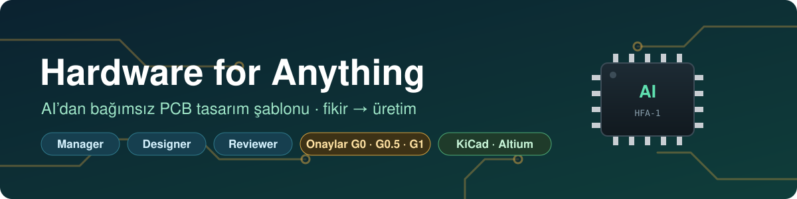
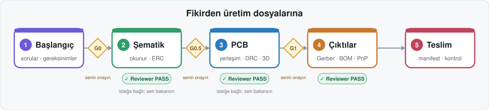
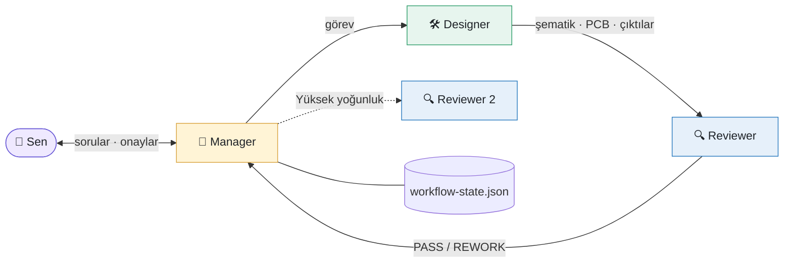
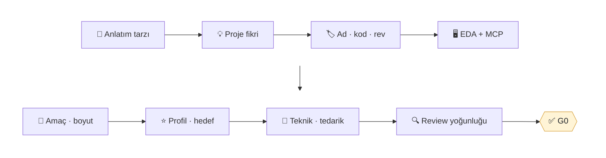
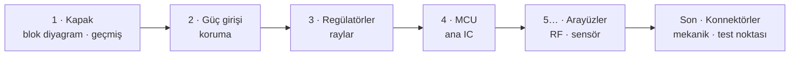
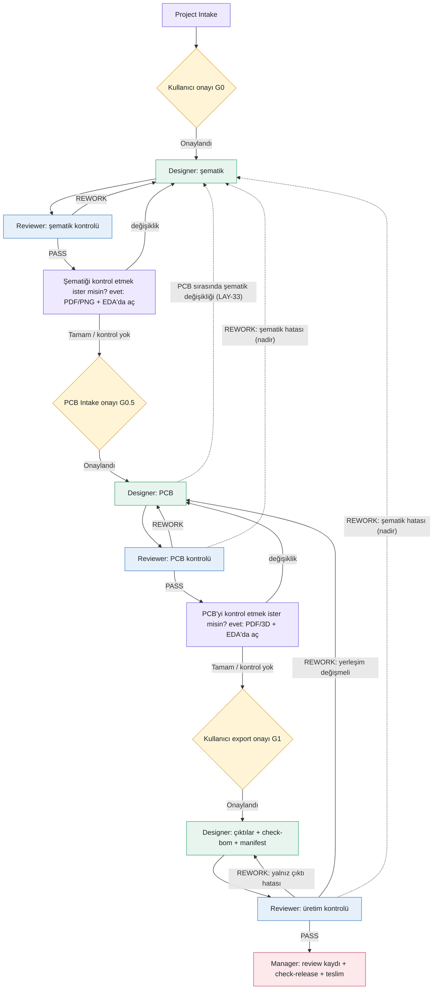

<p align="center"></p>

# Hardware for Anything · AI'dan Bağımsız Donanım Tasarım Şablonu

[English](README.md) · **Türkçe**

**Model ve platformdan bağımsız, tekrarlanabilir donanım tasarım projesi; maliyet/performans dengesi proje hedefine göre seçilir.**

[](https://github.com/d0ukan/hardware-for-anything/actions/workflows/tests.yml) · Lisans: [MIT](LICENSE) · Sürüm: v1.43 ([değişiklikler](CHANGELOG.md))

[](https://github.com/d0ukan/hardware-for-anything/generate)    

Bu şablon tek bir yönetici ajan ve iki uzman rol ile şematikten PCB'ye kadar tasarım, bağımsız review, ortak donanım kütüphanesi ve kontrollü üretim çıktısı hazırlamak için kullanılır. Kural ve rol dosyaları İngilizcedir; AI asistanlar sizin dilinizde cevap verir.

| Rol | Taşınabilir rol tanımı | Görev |
| :--- | :--- | :--- |
| Hardware Manager | `agents/Manager.md` | Gereksinimler, kararlar, görevler ve onaylar |
| Hardware Designer | `agents/Designer.md` | Şematik, footprint, 3D model, PCB ve düzeltmeler |
| Hardware Reviewer | `agents/Reviewer.md` | Bağımsız tasarım ve üretim dosyası doğrulaması |

<p align="center"></p>

## Bir bakışta

| | | | |
| :---: | :--- | :---: | :--- |
| 🤖 | **Her AI, her EDA, her işletim sistemi:** Claude, Codex, Gemini …; KiCad, Altium, EasyEDA; Windows, macOS, Linux | 🚦 | **Her kapıyı sen onaylarsın:** gereksinim G0, PCB girdileri G0.5, export G1 |
| 🔍 | **Bağımsız review:** Hafif, Orta veya Yüksek (iki Reviewer) | 📐 | **Okunur şematik:** tel, güç sembolü, standart sayfa |
| 🔌 | **MCP kurulumu önerilir:** bu proje ya da tüm projeler, sadece senin onayınla | 🌍 | **Yerel tedarik:** ülken, kullanıcının aldığı modüller, drop-in muadiller |
| 📡 | **Diferansiyel ve RF:** şematikte belli, PCB'de çift olarak çizilir | 📦 | **Teslim kontrolleri:** BOM/PnP, manifest hash, git'li veya git'siz değişiklik bağlama |

### Ekip nasıl çalışır



## AI sohbetinde repo linkiyle başlamak

En kısa yol: herhangi bir AI asistanına repo linkini verip şunu yaz:

> Bu repoyu incele (önce AGENTS.md ve llms.txt). Bu repoyu kullanarak bir kart tasarlamak istiyorum.

AI şunları yapar ([AGENTS.md](AGENTS.md), "AI started from a repo link" bölümü):
- Tüm kuralları baştan okumaz; dizini ve aşamaya göre okuma setini kullanır. Bu token ve kredi tasarrufu sağlar.
- Senden GitHub'da **Use this template** ile kendi kopyanı oluşturmanı ister.
- Dosya erişimi yoksa (web sohbeti) kararları sohbette tutar, dosyalara yapıştıracağın içerikleri ve çalıştıracağın komutları verir; çalışmamış kontrolü geçmiş göstermez. `projectctl.py next` çıktısını yapıştırırsan oradan devam eder.
- İlk soruları kısa adımlarla, aşağıdaki "İlk sorular" sırasıyla sorar.
- Şebeke/yüksek gerilim, çok hücreli lityum, hastaya bağlı medikal veya Havacılık DAL A/B gibi durumlarda insan mühendis onayını zorunlu tutar (AI-09).

Dosya ve EDA erişimi olan bir araçta (Claude Code, Codex, Gemini CLI vb.) kendi kopyanı açıp aşağıdaki hızlı başlangıçla devam et.

## Hızlı başlangıç

1. Bu repoyu GitHub'da **Use this template** ile kopyala (veya ZIP'i aç). Repo sahibi bu düğmeyi **Settings → General → Template repository** ile açar.
2. Proje klasörünü kullandığın AI geliştirme aracında aç. Dosya ve EDA erişimini, yetkileri ve ajan desteğini kontrol et.
3. Kullandığın AI'a şu talimatı ver:

   > AGENTS.md ve agents/Manager.md talimatlarını uygula. Project-README.md ve project/workflow-state.json dosyalarındaki mevcut durumu kontrol et. Yeni projeyse Project Intake sorularını sor; mevcut projeyse kaldığımız yerden devam et. Onayım gelmeden ilgili tasarım aşamasına başlama.

4. Manager kararları `Project-README.md` dosyasına, onay/review durumunu `project/workflow-state.json` dosyasına kaydeder. G0 öncesinde gereksinimleri, layout öncesinde G0.5 ile PCB girdilerini onaylatır.
5. Aktif görev gerektiğinde Designer veya Reviewer'a verilir. Sıradaki adım ve komutu: `python scripts/projectctl.py next`.

## İlk sorular



## Proje kimliği ve çıktı isimleri

Manager anlatım tercihi ve proje fikrinden (INT-55) sonra proje adı, proje kodu, revizyon ve varsa varyantı sorar (INT-49). Kod biçimini kullanıcı belirler. Tüm çıktılar bu kimlikle adlandırılır:

| Durum | Önek | Örnek dosyalar |
| :--- | :--- | :--- |
| Revizyon | `DR00627-R01` | `DR00627-R01_BOM.csv`, `_PnP.csv`, `_SCH.pdf`, `_ASSY.pdf`, `_Gerber.zip` |
| Varyant A | `DR00627-AV-R01` | `DR00627-AV-R01_BOM.csv`, `DR00627-AV-R01_PnP.csv` |

- Bakır, outline veya stack-up değişirse yeni **revizyon**; sadece takılan parçalar değişirse **varyant** (REL-01).
- Revizyon atlatılırken kullanıcıya "ne değişti, neden?" sorulur ve `REVISION-HISTORY.md` dosyasına yazılır (REL-02).
- AI "Ne yapmak istiyorsun? Yoksa ben proje fikri önereyim mi?" diye sorar; fikir istersen önceki projelerine ve ilgi alanlarına göre 3–5 fikir sunar (INT-55). Senin seçmediğin bir projeye başlamaz.
- Başta **boyut sınırı** (konnektörler dahil en fazla en × boy × yükseklik, ya da "mümkün olduğunca küçük" / "sınır yok", INT-19) ve **katman sayısı** sorulur: senin hedefin, ya da AI uygun en düşük sayıyı (2, 4, 6 …) seçip nedenini söyler (INT-20).
- **Tasarımı sen de kontrol edebilirsin (isteğe bağlı):** şematik review'dan sonra AI "Şematik bitti, kontrol etmek ister misin?" diye sorar. Evet dersen şematiği PDF ve görsel olarak gösterir, EDA programında açıp bakmanı ister; hayır dersen devam eder. G1'den önce PCB için aynısı 3D görsellerle yapılır (SCH-08, LAY-32).
- **İnsanın okuyabileceği şematik** (SCH-09…12): blok içinde gerçek tel, beslemeler için güç sembolü, az net etiketi, üst üste binmeyen yazılar, soldan sağa akış. AI kendi çiziminin PNG'sine bakar, ERC çalıştırır ve net listesini verir; okunmuyorsa Reviewer REWORK verir (REV-15).
- Her komponente mümkünse en az 1 drop-in muadil bulunur (DFM-14).
- **Komponentler tek yüzde mi, iki yüzde mi** PCB'den önce sorulur (PCB-22); varsayılan tek yüz (daha ucuz).
- **Yerleşim yoğunluğu** da sorulur (PCB-23): Yüksek (sıkı) · Orta (dengeli, varsayılan) · Düşük (ferah). Boyut sınırı veya kutu varsa yoğunluk otomatik ona göre olur ve sana söylenir.
- **Kenar mesafesi ve via tenting sorulur** (PCB-24, PCB-25): varsayılan parça–kenar 3 mm; via'lar varsayılan kapalı (tented), güç via'ları daha büyük ve açık olabilir.
- **Temiz silkscreen ve tam 3D:** silkscreen pad'e binmez (DRC hatası olarak ve render ile kontrol edilir); her parçanın 3D modeli olur. Eksik model sana bildirilir ve sorulur: STEP'i sen mi paylaşırsın, AI kurulu CAD programında mı çizer, yoksa (onayınla) FreeCAD + MCP kurup orada mı çizer (LAY-30, LAY-34).
- **Test noktaları başta sorulur** (INT-58): yok, elle ölçüm padi (varsayılan 1.5 × 1.5 mm SMD, küçük kartta 1.0 mm) veya pogo pinli fikstür (≥ 1.0 mm pad, 2.54 mm aralık, tek yüz, hizalama delikleri); ayrıca hangi hatlarda olacağı.
- **Fabrika çıktıları:** BOM ve PnP CSV, PnP ayrıca `.txt`; istenirse JLCPCB formatında BOM (sadece LCSC/Asya tedarikinde, Aerospace'te asla) ve fiyat, stok ve toplamlı ayrıntılı Excel BOM (bölüm 09).
- **FMECA için Aerospace BOM:** yetkili distribütör, CoC/lot, nitelik (MIL/QML/AEC-Q, VID/SMD), FIT, MTBF ve kaynağı; entegrelerin errata belgeleri kontrol edilir (AVI-11, AVI-12).
- **Temiz üretim dokümanları:** her sayfada aynı antetle tek bir standart görünüm; verirsen logon, firma adın, imzan veya doküman numaran eklenir; dili sen seçersin (varsayılan İngilizce); her PDF ve çizim katmanı render edilip üst üste binen yazı için kontrol edilir (REL-05).
- **Sadece alınabilir parçalar:** NRND / Son Alım / EOL / Obsolete parçalar senin onayın olmadan kullanılmaz; stok kontrol edilir, BOM'a yazılır (`Lifecycle`, `Stock`, `Checked`) ve G1'den önce tekrar kontrol edilir; `check-bom` riskli parçada uyarı verir (DFM-17, REV-20).
- **Adım adım, önce şematik sonra PCB:** şematik kısa PCB notlarıyla biter. PCB sırasında şematik hatası bulunursa AI şematiğe döner, düzeltir, neyin neden değiştiğini sana anlatır (şematik kontrolü seçtiysen gösterip onayını bekler), Reviewer'a tekrar kontrol ettirir ve PCB'ye devam eder (SCH-16, LAY-33).
- **Standart şematik sayfaları:** her sayfa aynı şablonu kullanır (yatay A4, KiCad `.kicad_wks` `Hardware-Library/sheet-templates/` içinde); başlık kutusu eksiksizdir (ad, kod, revizyon, varyant, sayfa x/y, tarih, tasarlayan, kontrol eden) ve sayfa sırası sabittir: kapak → güç → regülatörler → MCU → arayüzler → konnektörler (SCH-14, SCH-15, REV-18).



- **Diferansiyel hatlar belli ve çift olarak çizilir:** şematikte yan yana çizilir, yanına "USB D+/D− · 90 Ω diff" gibi not yazılır ve EDA'nın çift olarak tanıyacağı isim verilir; PCB'de diferansiyel çift aracıyla sabit aralıkla çizilir, çift tablosu (empedans, uzunluk farkı) Reviewer'a verilir (SCH-13, DIF-09…11, REV-17).
- **Modüller için yerel tedarik:** AI ülkeni ve kartın nerede dizileceğini sorar. PCBA firmasının stokta tutmadığı bir modül veya parça için onu nereden alabileceğini sorar (yapabiliyorsa yerel mağazalara bakar), mümkünse stoktaki bir soket kullanır, footprint'i senin alacağın ürüne göre çizer (klonlar farklı olabilir) ve PCBA BOM'unda KULLANICI TEMİN EDER / DNP olarak işaretler (INT-56, INT-57, DFM-16).
- **Review yoğunluğu** G0'dan önce en son sorulur (INT-53). Riskli kartlarda (Aerospace, RF, batarya, SELV üstü gerilim) en az Orta.

  | Yoğunluk | Reviewer | Kontrol |
  | :--- | :---: | :--- |
  | 🟢 **Hafif / Light** | 1 | Sadece kritik kontroller |
  | 🟡 **Orta / Medium** (varsayılan) | 1 | Tam kontrol listesi |
  | 🔴 **Yüksek / High** | 2 bağımsız | Tam liste iki kez; ikisi de PASS vermeli |

- Kritik olmayan sorularda (logo, silkscreen yazıları, designator, imza) **"Sonra karar ver"** seçeneği vardır; kart üzerindeki kararlar en geç G0.5'te kesinleşir (INT-51).
- Silkscreen soruları (PCB-17…21): logo/ikon, kart kodu (silk/bakır, top/bottom), konnektör etiketi (pin no/net adı), designator (açık/gizli, boyut, konum), imza/easter egg. Silkscreen her yüzde çakışmasız olur (LAY-30).
- Çıktı seti (bölüm 09): Gerber, BOM, PnP, şematik PDF, Draftsman tarzı montaj çizimi (`_ASSY.pdf`), fab notu. Boş şablonlar `Manufacturing/templates/` içindedir; bring-up ve review checklist'leri de var.

## Kalite profilleri

Manager proje başında kartın seviyesini sorar. Profil kuralların sertliğini belirler; kullanıcı her varsayılanı değiştirebilir.

| Profil | Ne için | Ne değişir |
| :--- | :--- | :--- |
| 🧪 **Hobi** | Kişisel proje, prototip, en düşük maliyet | JLCPCB/PCBWay standart hattı, en az katman, ucuz ve kolay tedarik |
| 🏭 **Endüstriyel** | Sahada uzun süre güvenilir çalışma | −40…+85 °C komponent, giriş korumaları, uzun ömürlü ve çok kaynaklı parça |
| ✈️ **Aerospace (Havacılık)** | Uçuş, askeri, yüksek güvenilirlik | `Hardware-Rules.md` bölüm 08: IPC Class 3, derating, DO-160/MIL-STD isterleri, izlenebilirlik |

**Tasarım hedefi de seçilir (INT-48):** Maliyet öncelikli, Dengeli (fiyat/performans) veya Performans öncelikli. Varsayılan öneri: Hobi → Maliyet, Endüstriyel → Dengeli, Aerospace/askeri → Performans (kullanıcı maliyet hedefi vermediyse). Hiçbir hedefte güvenilirlik ve doğrulama maliyet için kısılmaz.

**RF, batarya ve Havacılık isteğe bağlıdır.** İlgisizse kuralları ve soruları tamamen atlanır. RF varsa band sorulur: RF-A (< 1 GHz), RF-B (1–6 GHz), RF-C (> 6 GHz).

## Proje yapısı

| Dosya / klasör | Amaç |
| :--- | :--- |
| `README.md`, `README.tr.md` | İngilizce ve Türkçe genel bakış |
| `AGENTS.md` | Tüm AI sistemleri için ortak çalışma talimatları; repo linkiyle başlayan AI bölümü |
| `llms.txt` | AI araçları için giriş dosyaları listesi |
| `agents/` | Platformdan bağımsız rol ve handoff talimatları |
| `.codex/`, `CLAUDE.md`, `.claude/agents/`, `GEMINI.md` | İsteğe bağlı Codex, Claude Code ve Gemini CLI adaptörleri |
| `Hardware-Rules.md` | Kural dizini ve aşamaya göre okuma seti |
| `rules/` | Bölüm bölüm teknik kurallar (00 intake … 10 batarya) |
| `Hardware-Roles.md` | Roller, iş akışı, review ve token politikası |
| `examples/` | Dolu örnek proje (`DR00001` USB-C LED kartı); CI her push'ta kontrol eder |
| `Hardware-Library/` | Doğrulanmış symbol, footprint, 3D model, devre blokları ve standart şematik sayfa şablonu (`sheet-templates/`) |
| `Hardware/` | Native EDA projesi (KiCad, Altium vb.) |
| `Mechanical/` | Projeye özel mekanik kaynaklar ve isteğe bağlı komple CAD assembly |
| `Review/` | İsteğe bağlı kullanıcı kontrolü için taslak PDF/görseller (SCH-08, LAY-32); git'e girmez |
| `docs/` | README görselleri |
| `Manufacturing/` | Onay sonrası üretilen dosyalar; `templates/` içinde boş BOM, PnP, şematik çıktı, montaj çizimi, fab notu ve checklist'ler |
| `Project-README.md` | Proje bilgi/ister/karar şablonu; Manager güncel tutar |
| `REVIEW_LOG.md` | Bağımsız review bulguları (`F-001` …) |
| `REVISION-HISTORY.md` | Revizyon geçmişi: ne değişti, neden, errata |
| `project/workflow-state.json` | Makine tarafından kontrol edilebilir iş akışı durumu |
| `scripts/projectctl.py` | Modelsiz onay, commit bağı, BOM/PnP, teslim listesi ve release kontrolü; `next` |
| `scripts/check_repo.py` | Şablon tutarlılık kontrolü: kural kimlikleri, dizin aralıkları, linkler, sürümler, CSV |
| `tests/`, `.github/workflows/` | Otomatik testler ve CI |
| `MCP-SETUP.md`, `examples/mcp/` | EDA programına ve AI istemcisine göre MCP kurulumu, örnek ayar |
| `CHANGELOG.md`, `LICENSE`, `CONTRIBUTING.md` | Sürüm geçmişi, MIT lisansı, katkı kuralları |

## İş akışı



Her Reviewer kontrolünün sonucu `PASS`, `REWORK` veya `BLOCKED` olur. `REWORK` çıkarsa Designer düzeltir, Reviewer etkilenen alanları tekrar kontrol eder. Üretim kontrolünde sorun yalnız çıktıdaysa sadece çıktılar yeniden üretilir; yerleşim değişmeliyse PCB aşamasına dönülür ve G1 yeniden alınır. PCB veya üretim kontrolünde şematik hatası bulunursa (nadir, kesikli oklar) şematiğe dönülür: şematik review, PCB güncellemesi ve review, G1 yeniden yapılır (şematik dosyası değişince `projectctl` eski kayıtları geçersiz sayar). `BLOCKED` durumunda eksik bilgi, araç veya onay gelene kadar akış durur.

**Release sırası (REL-04):** Manager teslim listesini kaydeder (`deliverables`) → Designer çıktıları üretir, `check-bom` ve en son `manifest` çalıştırır → Reviewer inceler → Manager `review manufacturing PASS` kaydeder (manifest hash'i saklanır) → `check-release`.

## Token ve fiyat/performans

- Ana oturum Manager'dır; yalnızca Designer ve Reviewer başlatılır (ikinci Reviewer yalnızca High yoğunlukta).
- AI her aşamada yalnızca `Hardware-Rules.md` içindeki "Reading set by stage" (aşamaya göre okuma seti) tablosundaki dosyaları okur.
- Basit işler önce deterministik araç ve script ile çözülür (`projectctl.py`, `check-bom`).
- Varsayılan model/efor düşük maliyetlidir; zor teknik işler için uygun model seçilir.
- Doğrulanmış kütüphane girişleri yeniden kullanılır; kontrol raporları kısa tutulur.

### Model seçimi ve platform adaptörleri

Model adları ve sağlayıcı sabitlenmemiştir. Economy, Standard ve Advanced seviyelerini mevcut istemcideki seçeneklere göre eşleştir.

| Ortam | Kullanım |
| :--- | :--- |
| Codex | İsteğe bağlı `.codex/` ayarları; Manager ana oturum, Designer/Reviewer custom agents. |
| Claude Code | `CLAUDE.md` ortak kuralları içe aktarır; `.claude/agents/` aynı uzman rollerine yönlendirir. |
| Gemini CLI | `GEMINI.md` ortak kuralları içe aktarır. |
| DeepSeek ve diğerleri | İstemci ajan/araç desteği sağlıyorsa aynı rol tanımlarını kullan; aksi halde [agents/README.md](agents/README.md) içindeki manuel görev aktarımı. |

Reviewer'ın yazmaması bir rol kuralıdır, ayrı bir işletim sistemi sandbox'ı değildir. Resmi adaptör referansları: [Codex subagents](https://learn.chatgpt.com/docs/agent-configuration/subagents), [Claude Code subagents](https://code.claude.com/docs/en/sub-agents), [Claude Code project instructions](https://code.claude.com/docs/en/memory), [Gemini CLI context files](https://geminicli.com/docs/cli/gemini-md/).

### AI değiştirirken kaldığın yerden devam et

Proje tek sohbette kalır; AI seni yeni bir sohbet açmaya yönlendirmez (AI-10). AI'ı kendin değiştirirsen yeni oturumda `AGENTS.md`, atanacak rol ve mevcut `Project-README.md`, `project/workflow-state.json`, `REVIEW_LOG.md` üzerinden ilerle; `projectctl.py next` sıradaki adımı söyler. Bir modeli Designer, başka bir modeli Reviewer olarak kullanabilirsin; önceki onaylar ve gerçek review kayıtları korunur.

## EDA & MCP entegrasyonu

Şablon belirli bir EDA veya MCP sunucusuna bağımlı değildir. MCP, native CLI, scripting/API veya GUI kullanılabilir. AI önce hangi EDA programını kullandığını sorar, sonra uygun MCP sunucusunu kurmayı önerir (sadece bu proje için ya da tüm projeler için); yalnızca sen evet dersen kurar (INT-54). Adımlar: [MCP-SETUP.md](MCP-SETUP.md).

| EDA | Entegrasyon seçenekleri ve kaynaklar |
| :--- | :--- |
| KiCad | [Native CLI](https://docs.kicad.org/10.0/en/cli/cli.html), [IPC API](https://dev-docs.kicad.org/en/apis-and-binding/ipc-api/index.html), [KiCAD-MCP-Server](https://github.com/mixelpixx/KiCAD-MCP-Server), [Seeed kicad-mcp-server](https://github.com/Seeed-Studio/kicad-mcp-server) |
| Altium Designer | [Resmi MCP Server](https://docs.developer.altium.com/ad-mcp-docs/), [altium-mcp](https://github.com/coffeenmusic/altium-mcp), [scripting](https://www.altium.com/documentation/altium-designer/scripting) |
| EasyEDA Pro | [Resmi Extension API](https://prodocs.easyeda.com/en/api/guide/) ve [üçüncü taraf MCP örneği](https://github.com/vlab-software/easyeda_mcp) |
| Autodesk EAGLE (eski) | Autodesk, EAGLE'ı Haziran 2026'da sonlandırdı. Yalnızca mevcut projeleri okumak veya KiCad/Fusion'a taşımak için kullan. |

MCP sürümü, EDA uyumu ve gerçek araç fonksiyonları proje başında doğrulanır. Reviewer MCP kullanırken yalnızca okuma araçlarıyla çalışır (REV-13).

**[KiCAD-MCP-Server](https://github.com/mixelpixx/KiCAD-MCP-Server) kullanırken:**
- `stable` dalı, v2.9 veya üstü kullan.
- Token tasarrufu için `KICAD_MCP_TOOLBOXES=core` ile başla.
- Reviewer için `KICAD_MCP_OPERATING_MODE=readonly`, yalnız export için `manufacturing`.
- Autorouter (Freerouting) yalnızca kritik olmayan netlerde `routeNets`/`excludeNets` ile (LAY-14).
- Şematik düzenlerken dosya KiCad'de açık olmasın.
- `KICAD_MCP_DEV=1` logu `logs/` klasörüne yazar; klasör `.gitignore` içindedir.

**[altium-mcp](https://github.com/coffeenmusic/altium-mcp) kullanırken:**
- Readonly modu yoktur; Reviewer yalnız `get_*`, `check_*`, `run_drc`, ERC, `preview_eco`, `compare_netlist` kullanır.
- Stack-up, empedans, diff pair ve length matching kuralları Altium'da elle girilir.
- `route_connections` autorouter'dır; kritik hatlarda kullanılmaz (LAY-14). `run_altium_script` her kullanımda kullanıcı onayı ister.
- `git pull`/`checkout` öncesi dokümanları kaydet ve kapat. OutJob çıktı yolunu `Manufacturing/<rev>/` yap; `*.OutJob` değişikliği tasarım değişikliği sayılmaz.
- Altium tasarım dosyaları binary'dir; aynı dosyayı aynı anda tek kişi düzenler.

## Yerleşim ve routing

`Hardware-Rules.md` bölüm 04 (`rules/04-schematic-layout.md`):

| Grup | Kurallar | Kısaca |
| :--- | :--- | :--- |
| Şematik | SCH-01…SCH-16 | Bloklar, datasheet, güç ağacı (PI), pin bazlı decoupling, SI hazırlığı, kısıt işaretleme, 0 Ω / DNP opsiyonu, kullanıcı kontrolü, okunurluk, diferansiyel çiftler, sayfa şablonu ve sırası |
| Genel | LAY-01…LAY-07 | Decoupling, güç hattı, bölgeleme, referans düzlemi, 45°, test point, silkscreen |
| Yerleşim | LAY-08…LAY-13 | Referans layout, yerleşim sırası, giriş koruması, switching döngüsü, kristal, termal, hizalama |
| Routing | LAY-14…LAY-24 | Routing sırası, net class ve IPC-2152, katman kullanımı, bölünmüş düzlem, clock aralığı (3W merkezden), analog GND, güç dağıtımı, yüksek gerilim, pad girişi/teardrop, en kısa doğrudan yol, onaylı free-angle |
| SI / PI | LAY-25…LAY-29 | Decoupling döngüsü, kritik uzunluk, empedans eşleştirme, length/delay matching, bitiş kontrolü |
| Silkscreen, 3D ve değişiklik | LAY-30…LAY-34 | Her yüzde çakışmasız silkscreen; işaretleme kararlarının uygulanması; kullanıcı PCB kontrolü; layout sırasında şematik değişikliği; her parça için 3D model |

Özel üretim istenmediyse JLCPCB ve/veya PCBWay standart kabiliyetleri esas alınır (DFM-00).

## Batarya, RF ve High-Speed

- **Batarya (bölüm 10, BAT-01…08):** Kart pille çalışıyor veya batarya şarj ediyorsa açılır: koruma, şarj IC, NTC, layout, uyku akımı, testler.
- **RF ve high-speed (bölüm 05):** Kontrollü empedans, SI/PI profili ve banda göre RF kuralları (RF-01…RF-09). Düşük hızlı kartlarda N/A. Şablon tek başına RF performansını garanti etmez.

## Yerel kontrol komutları

Python 3.10+ yeterlidir; ek paket, API anahtarı veya LLM çağrısı gerekmez. **Windows, macOS ve Linux**'ta aynı çalışır (CI her push'ta üçünde de test eder).

| İşletim sistemi | Python kurulumu | Komut |
| :--- | :--- | :--- |
| 🪟 Windows | python.org kurulumu veya `winget install Python.Python.3.12` | `python` (veya `py`) |
| 🍎 macOS | `brew install python` veya python.org kurulumu | `python3` |
| 🐧 Linux | dağıtım paketi (`apt install python3`, `dnf install python3`) | `python3` |

Aşağıdaki örnekler `python` kullanır; macOS/Linux'ta `python` bulunamazsa `python3` yaz.

```bash
python scripts/projectctl.py next            # sıradaki eksik adım ve komutu
python scripts/projectctl.py status
python scripts/projectctl.py check-layout
python scripts/projectctl.py check-export
python scripts/projectctl.py check-bom
python scripts/projectctl.py check-release
python -m unittest discover -s tests -v
python scripts/check_repo.py
```

Kayıtlar için JSON'u elle düzenleme; komutları kullan. `--revision` değeri her zaman `design_revision` ile aynıdır (ör. `R01`). Tam sıra [project/README.md](project/README.md) içindedir; kısa hali:

```bash
python scripts/projectctl.py set project_name "Sensör kartı"
python scripts/projectctl.py set project_code DR00627
python scripts/projectctl.py set design_revision R01
python scripts/projectctl.py set requirements_revision REQ-1
python scripts/projectctl.py set review_depth Medium
python scripts/projectctl.py approve G0 --revision REQ-1 --evidence "Kullanıcı onayı" --by "<isim>"
python scripts/projectctl.py review schematic PASS --revision R01 --evidence "REVIEW_LOG.md, R01 şematik"
python scripts/projectctl.py set pcb_requirements_revision PCB-1
python scripts/projectctl.py approve G0.5 --revision PCB-1 --evidence "Kullanıcı PCB onayı"
python scripts/projectctl.py review pcb PASS --revision R01 --evidence "REVIEW_LOG.md, R01 PCB"
python scripts/projectctl.py approve G1 --revision R01 --evidence "Kullanıcı export onayı"
python scripts/projectctl.py deliverables BOM PnP Gerber SCH ASSY FAB
python scripts/projectctl.py manifest
python scripts/projectctl.py review manufacturing PASS --revision R01 --evidence "REVIEW_LOG.md, R01 üretim"
python scripts/projectctl.py check-release
python scripts/projectctl.py block F-001
python scripts/projectctl.py revoke G1     # onayı PENDING'e döndürür
```

- **Commit bağı:** Proje git deposuysa `approve` ve `review` o anın commit'ini kaydeder. Review'dan sonra `Hardware/` altında değişiklik veya git'e eklenmemiş yeni dosya olursa kapı kapanır. Tasarım commit edilmeden `review ... PASS` veya `approve G1` kaydedilmez.
- **Git olmadan:** proje düz bir yerel klasörde de çalışır (zip indirme, git yok); AI istemcisiyle ya da sadece terminalle. Kayıtlar her zaman tasarım dosyalarının SHA-256 özetini de saklar; sonradan değişiklik olursa (git sonradan kaldırılsa bile) kapı yine kapanır. EDA yedek ve kilit dosyaları sayılmaz.
- **Otomatik commit yok:** `projectctl.py` hiçbir zaman commit veya push yapmaz; AI her commit'ten önce sana sorar, push'u sadece sen istersen yapar (AI-11).
- **Manifest bağı:** `review manufacturing PASS` manifestin hash'ini saklar; manifest sonradan yeniden üretilirse `check-release` yeniden review ister.
- **Teslim listesi:** `deliverables` içindeki her çıktı (`<kod>-..._BOM.csv`, `_Gerber.zip` …) release'te bulunmalıdır.
- **`check-bom`:** BOM ile PnP eşleşmesi, Qty, DNP, MPN, `R1-R3` aralıkları, sayısal koordinatlar; muadil eksikse uyarır. Noktalı virgüllü veya UTF-8 olmayan CSV'de açık hata verir.

Yeni projede `check-layout`, `check-export` ve `check-release` komutlarının başarısız olması normaldir. Araç kayıtların tutarlılığını doğrular; onayın gerçekliğini veya kartın elektriksel doğruluğunu kanıtlamaz ve Gerber/BOM/PnP üretmez.

## Büyük dosyalar

STEP modelleri ve zip çıktıları büyüdükçe kendi proje kopyanda Git LFS kullanmayı düşün: `git lfs install` ve `git lfs track "*.step" "*.zip"`. Şablon LFS'i varsayılan olarak açmaz.

## Donanım kütüphanesini büyütme

[Hardware-Library/README.md](Hardware-Library/README.md) dosyasındaki kayıt yöntemine ve ortak footprint katman haritasına (DFM-15) göre yalnızca doğrulanmış, lisansı uygun ve tekrar kullanılabilir varlıkları ekle.

> Bu şablon hazır bir PCB tasarımı değildir. EDA yazılımı, üretici, bileşen seçimleri, elektriksel tasarım ve gerçek doğrulamalar her proje için ayrıca belirlenir. AI aracının izinleri mevcut oturum ve kullanıcı kararlarıyla sınırlıdır.
